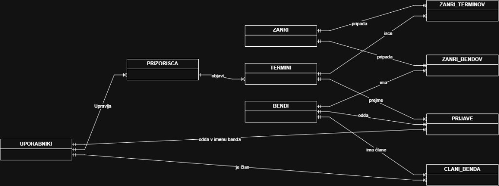

# Podatkovni model

Za shranjevanje podatkov uporabljamo relacijsko bazo **PostgreSQL**. Podatki so med seboj tesno povezani, saj uporabniki sestavljajo bende, bendi oddajajo prijave, prijave pa se nanašajo na termine posameznih prizorišč. Do baze dostopamo prek ORM-ja Prisma, več o tem je v dokumentu 04.

## Entitete

### Uporabnik (`uporabniki`)

| Polje | Opis |
|-------|------|
| id | primarni ključ |
| email | e-naslov za prijavo, unikaten |
| geslo_hash | zgoščeno geslo |
| prikazno_ime | ime, ki ga vidijo drugi |
| telefon | telefonska številka, neobvezna |
| vloga | `OBISKOVALEC`, `GLASBENIK`, `ORGANIZATOR` ali `ADMIN` |

### Bend (`bendi`)

| Polje | Opis |
|-------|------|
| id | primarni ključ |
| ime | ime benda |
| mesto | mesto, od koder je bend |
| opis | kratek opis benda |
| tehnicne_zahteve | kaj bend potrebuje za nastop |

### Član benda (`clani_benda`)

Povezuje uporabnike in bende, saj lahko en glasbenik igra v več bendih.

| Polje | Opis |
|-------|------|
| bend_id | tuji ključ na `bendi` |
| uporabnik_id | tuji ključ na `uporabniki` |
| vloga_v_bendu | `VODJA` ali `CLAN` |
| status | `POVABLJEN` ali `AKTIVEN` |

### Prizorišče (`prizorisca`)

| Polje | Opis |
|-------|------|
| id | primarni ključ |
| lastnik_id | tuji ključ na `uporabniki` (organizator) |
| ime | ime prizorišča |
| mesto | mesto |
| naslov | naslov |
| kapaciteta | največje število obiskovalcev |
| kontakt_telefon | telefon za dogovor o nastopih |
| kontakt_email | e-naslov za dogovor o nastopih |

### Termin (`termini`)

Razpisan termin in koncert sta ista entiteta. Ko organizator termin objavi, ta postane koncert, spremeni se le njegovo stanje.

| Polje | Opis |
|-------|------|
| id | primarni ključ |
| prizorisce_id | tuji ključ na `prizorisca` |
| datum | datum koncerta |
| st_bendov | koliko bendov išče organizator |
| nacin_placila | `HONORAR`, `DELITEV_VSTOPNINE` ali `BREZ` |
| znesek | znesek honorarja, lahko je prazen |
| rok_prijave | do kdaj se lahko bendi prijavijo |
| status | `ODPRT`, `ZAPRT`, `OBJAVLJEN`, `IZVEDEN` ali `ODPOVEDAN` |

### Prijava (`prijave`)

| Polje | Opis |
|-------|------|
| id | primarni ključ |
| termin_id | tuji ključ na `termini` |
| bend_id | tuji ključ na `bendi` |
| sporocilo | sporočilo organizatorju |
| status | `ODDANA`, `OZJI_IZBOR`, `SPREJETA`, `ZAVRNJENA`, `UMAKNJENA` ali `ODPOVEDANA` |

Par `termin_id` in `bend_id` je unikaten, zato se bend na isti termin lahko prijavi samo enkrat. Prijavo vedno odda vodja benda, zato je dovolj povezava na bend. Kontakt benda je telefon in e-naslov njegovega vodje.

### Žanr (`zanri`)

| Polje | Opis |
|-------|------|
| id | primarni ključ |
| ime | ime žanra, unikatno |

Žanri so z bendi povezani prek tabele `zanri_bendov`, s termini pa prek tabele `zanri_terminov`. Obe vsebujeta le tuja ključa.

## Povezave med entitetami

- **Uporabnik in bend (M:N prek `clani_benda`)**: uporabnik je lahko član več bendov, bend pa ima več članov.
- **Uporabnik in prizorišče (1:N)**: organizator upravlja eno ali več prizorišč.
- **Prizorišče in termin (1:N)**: prizorišče objavi več terminov.
- **Termin in prijava (1:N)**: na en termin se lahko prijavi več bendov.
- **Bend in prijava (1:N)**: bend se lahko prijavi na več terminov.
- **Bend in žanr (M:N)** ter **termin in žanr (M:N)**: na podlagi teh povezav iskanje ugotovi, kateri termini ustrezajo bendu.
- **Zasedba koncerta** nima svoje tabele. Sestavljajo jo sprejete prijave na termin.

## ER diagram

