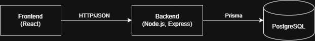

# Arhitektura in tehnološki sklad

## Arhitektura

GigSpot je sestavljen iz treh delov: spletnega odjemalca v **Reactu**, strežnika z **REST API-jem v Node.js in Expressu** ter podatkovne baze **PostgreSQL**.

### Glavni deli sistema

1. **Frontend.** Aplikacija v Reactu, ki teče v brskalniku. Ima javni del s koledarjem koncertov ter del, ki je dostopen po prijavi, kjer glasbeniki upravljajo bende in prijave, organizatorji pa termine in izbor zasedbe.
2. **Backend.** Strežnik v Node.js in Expressu, v katerem je vsa poslovna logika: prijava uporabnikov, preverjanje pravic, pravila pri prijavah na termine (rok, konflikti članov) in samodejno zavračanje, ko je zasedba polna.
3. **Podatkovna baza.** PostgreSQL hrani vse podatke, opisane v dokumentu 03.
4. **Samodejna opravila.** Del backenda, ki se izvaja v rednih presledkih. Zapira termine, ki jim je potekel rok za prijave, in koncerte po datumu označi kot izvedene.

### Komunikacija med deli sistema

- Frontend z backendom komunicira prek **REST API-ja** v obliki JSON, na primer `GET /api/slots` za iskanje terminov in `POST /api/slots/:id/applications` za oddajo prijave.
- Backend do baze dostopa prek **Prisme**. Akcije, ki spremenijo več zapisov hkrati (sprejem zadnjega benda, zaprtje termina in zavrnitev ostalih prijav), se izvedejo v eni **transakciji**, zato se zasedba ne more prenapolniti.

### Diagram



### Podatkovna baza

Uporabljamo PostgreSQL. Shemo vodimo v Prismi, spremembe pa uvajamo z migracijami. Za razvoj je na voljo skripta, ki v bazo vnese žanre in testnega uporabnika za vsako vlogo.

### Avtentikacija in upravljanje uporabnikov

- Uporabnik se registrira z e-naslovom in geslom ter izbere vrsto računa (`OBISKOVALEC`, `GLASBENIK` ali `ORGANIZATOR`). Vlogo `ADMIN` lahko dodeli le obstoječi administrator.
- Gesla so zgoščena z **bcrypt**.
- Ob prijavi backend izda **JWT**, ki se shrani v **httpOnly piškotek**.
- Pravice preverjamo po vlogi (na primer samo organizator lahko razpiše termin) in po lastništvu (na primer prijavo lahko odda le vodja benda, obravnava pa le lastnik prizorišča). Kontaktni podatki se pošljejo samo prijavljenim glasbenikom in organizatorjem.

### Lokalni zagon

```bash
# 1. podatkovna baza
docker compose up -d

# 2. backend
cd server
npm install
npx prisma migrate dev
npm run dev                # http://localhost:3000

# 3. frontend (v novem terminalu)
cd client
npm install
npm run dev                # http://localhost:5173
```

## Tehnološki sklad

| Področje | Tehnologije in orodja |
|----------|----------------------|
| Frontend | React, TypeScript, Vite, React Router, Tailwind CSS |
| Backend | Node.js, Express, TypeScript |
| Podatkovna baza | PostgreSQL, Prisma ORM |
| Avtentikacija | JWT v httpOnly piškotku, bcrypt |
| Lokalni razvoj | Docker Compose za bazo, npm, Git in GitHub |
| Drugo | node-cron za samodejna opravila, Vitest za teste |

## Arhitekturne odločitve

**Ločen frontend in backend.** Dela sta neodvisna, zato ju je lažje razumeti in testirati, isti API pa lahko kasneje uporablja tudi drug odjemalec.

**PostgreSQL namesto MongoDB.** Podatki so relacijski (člani v več bendih, žanri, prijave), pri izboru zasedbe pa potrebujemo transakcije.

**Prisma ORM.** Shema je pregledno zapisana na enem mestu, migracije so vgrajene, dostop do baze pa je tipsko varen.

**TypeScript na obeh straneh.** Pri prenašanju podatkov med frontendom in backendom je manj napak.

**JWT v httpOnly piškotku.** JavaScript do žetona ne more dostopati, strežniku pa ni treba hraniti sej.

**Lastna avtentikacija namesto zunanjega ponudnika (Auth0, Firebase).** Potrebujemo le e-naslov, geslo in nekaj vlog, projekt pa je mogoče zagnati lokalno brez zunanjih računov.

**Docker Compose za bazo.** Vsi razvijalci imajo enako različico PostgreSQL, ne da bi jo morali ročno nameščati.
