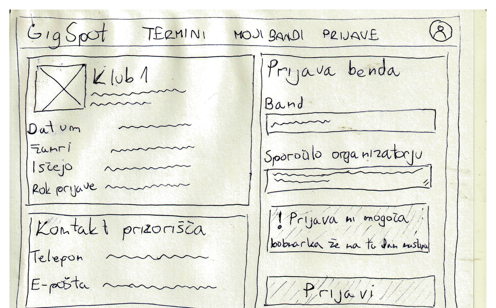
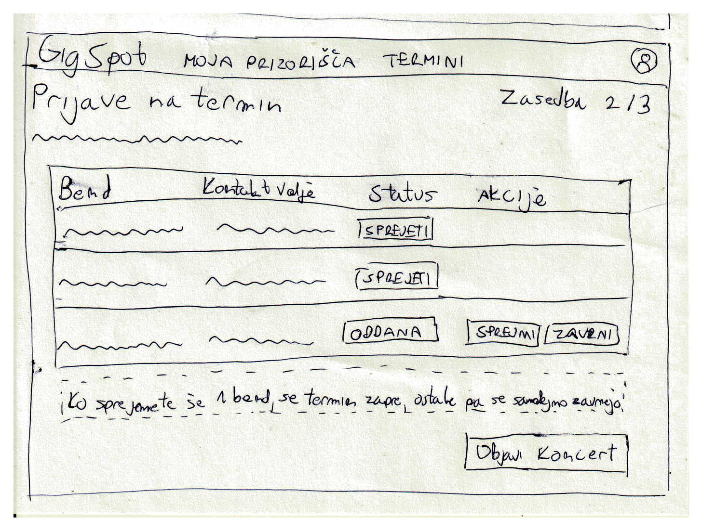
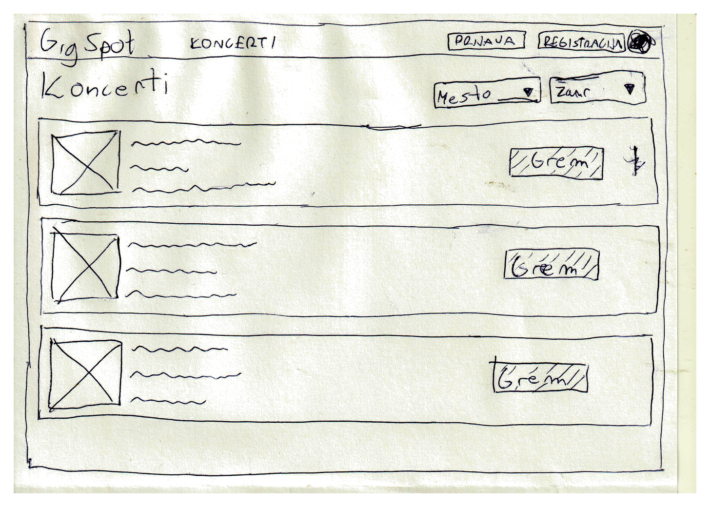

# Wireframes

Wireframi so ročno narisani in prikazujejo osnovni izgled treh pomembnejših zaslonov spletne aplikacije GigSpot. Izbrani so tako, da skupaj pokrijejo glavni potek MVP: vodja benda se prijavi na termin, organizator izbere zasedbo in objavi koncert, obiskovalec pa koncert najde na seznamu. Kažejo razporeditev strani, ne pa končnega dizajna ali pravih podatkov. Vsebina je prikazana s črtami, slike pa s kvadrati. Pri vsakem je navedeno, katere uporabniške zgodbe iz dokumenta `05-uporabniske-zgodbe.md` pokriva.

## 1. Prijava benda na termin

Na levi so podatki o terminu (prizorišče, datum, žanri, število bendov in rok prijave) in kontakt prizorišča, ki ga vidijo samo prijavljeni glasbeniki in organizatorji. Vrednosti so črte, za sliko prizorišča pa je kvadrat. Na desni je obrazec, s katerim vodja benda izbere bend in doda sporočilo organizatorju. Wireframe prikazuje primer, ko ima bobnarka benda na isti dan že nastop z drugim bendom, zato sistem prikaže opozorilo, gumb „Prijavi" pa je onemogočen.

**Pokriva:** US-02 (kontakt prizorišča), US-04, US-05

## 2. Izbor zasedbe

Zaslon organizatorja s prijavami na en termin. Zgoraj desno je prikazano, koliko mest v zasedbi je že zapolnjenih. Pri vsaki prijavi so vidni bend, kontakt vodje in stanje prijave, pri oddanih prijavah pa gumba „Sprejmi" in „Zavrni". Opomba pod tabelo opozori, da se bo termin ob naslednjem sprejemu zaprl, ostale prijave pa se bodo samodejno zavrnile. Z gumbom „Objavi koncert" organizator potrdi zasedbo.

**Pokriva:** US-06, US-07

## 3. Seznam koncertov

Javni seznam koncertov, ki ga vidi vsak obiskovalec, tudi brez prijave. Zgoraj desno sta Prijava in Registracija, koncerte pa lahko filtrira po mestu in žanru. Vsak koncert je kartica s prostorom za sliko ali datum, kratkim opisom in gumbom „Grem". Gumb deluje samo za prijavljene uporabnike.

**Pokriva:** US-08, delno US-12 (gumb „Grem" ni del MVP)